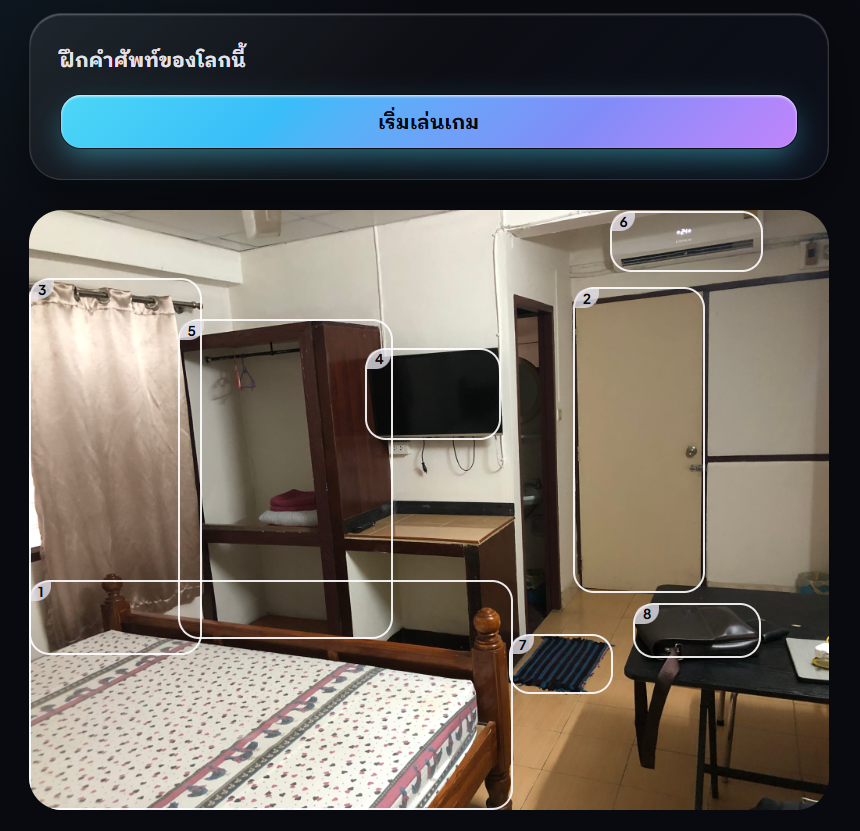
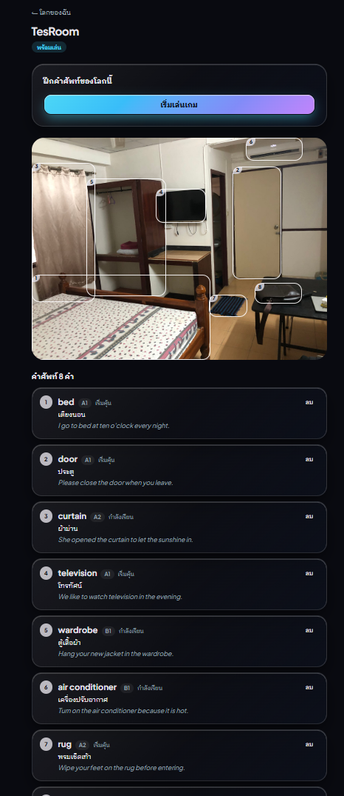
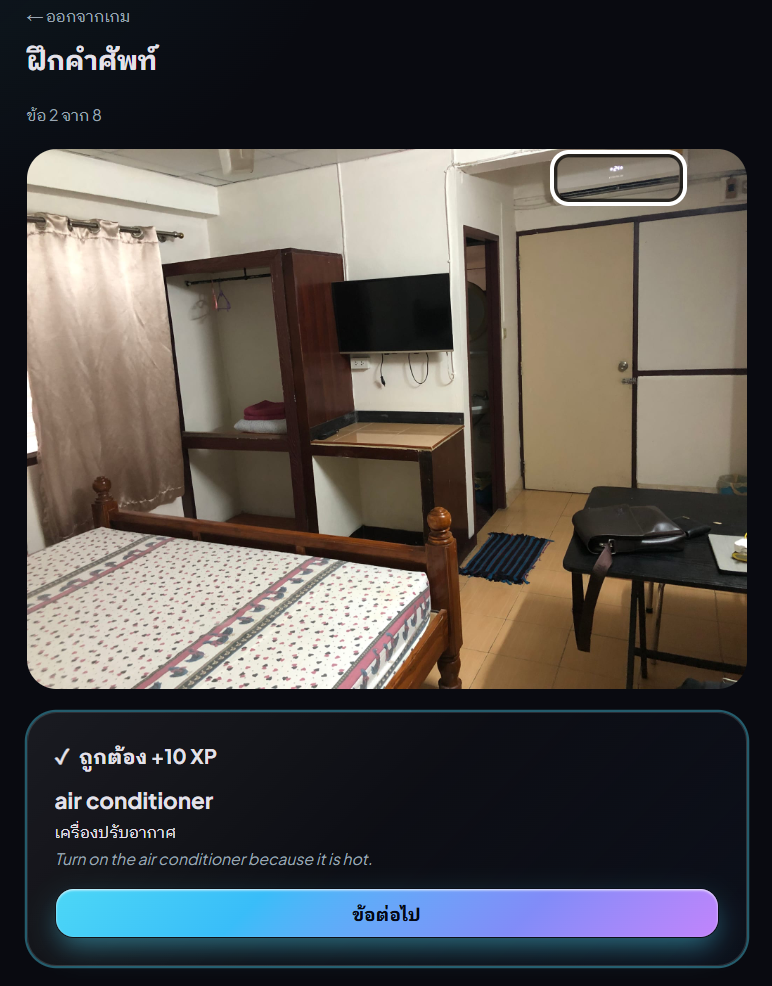
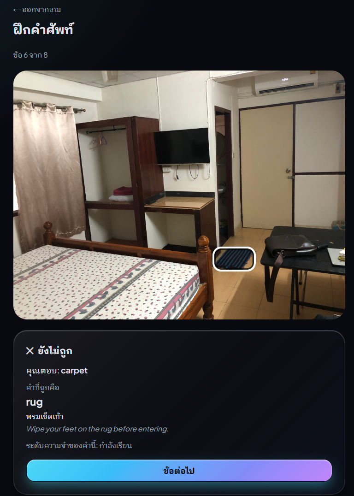
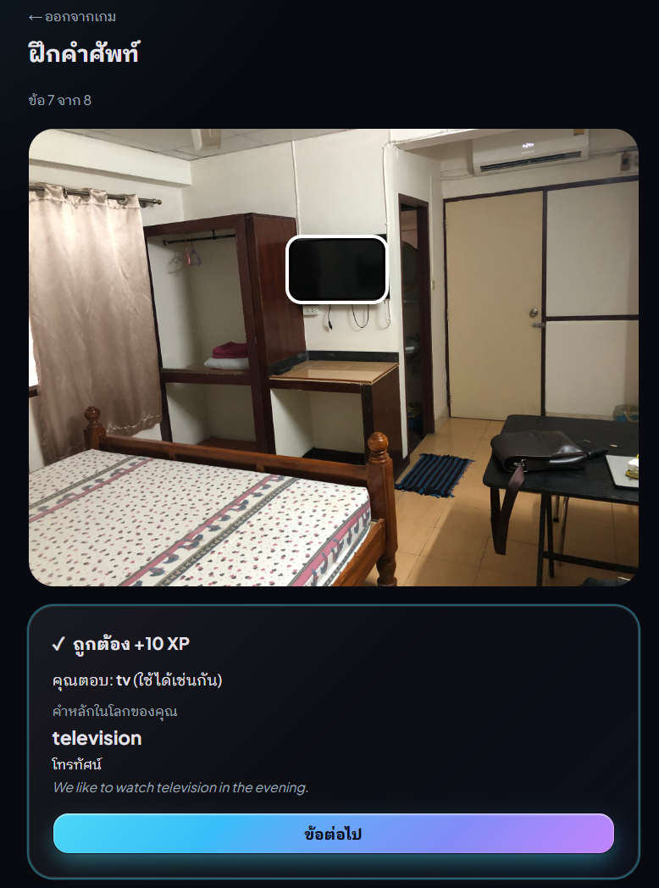
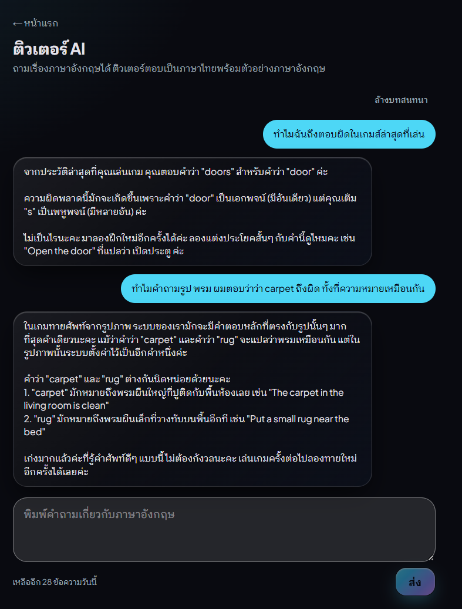

# LanguZe: an overview

> **Learn from your world.**

LanguZe (pronounced _แลน-กุ-เซ่_) is an AI-powered, gamified English-learning web app for Thai adults. A learner photographs a room, a desk or a street; the app finds the objects in the photo and turns them into vocabulary with Thai meanings, example sentences and a box around each object. The words become games, mistakes drive review, and an AI tutor answers questions using the learner's own words, mistakes and progress.

This repository is a curated selection from LanguZe's repository: its design documents, one complete path through the code from photo to vocabulary to game, the tests that hold it, and the way the work is done. **The full repository is private until the public opening; access is available on request.**

## Status

- **Release 1.0 was released on 2026-10-27** and runs in production. Until the public opening, Cloudflare Access keeps it closed to invited addresses.
- **The API is being ported from NestJS to ASP.NET Core** ([ADR-0006](code/docs/architecture/adr/0006-aspnet-core-api.md)), one slice per pull request, with the NestJS API as the reference until cutover. Platform, authentication, accounts, worlds and photo analysis are ported; learning sessions, progress, the tutor and the admin area are next.

## The app

| A world from a photo                                                              | Its words                                                                                           | Identify game                                                 |
| --------------------------------------------------------------------------------- | --------------------------------------------------------------------------------------------------- | ------------------------------------------------------------- |
|  |  |  |

| A wrong answer                                                                      | An accepted variant                                            | AI tutor                                                                                 |
| ----------------------------------------------------------------------------------- | -------------------------------------------------------------- | ---------------------------------------------------------------------------------------- |
|  |  |  |

In the last picture the tutor answers "why was _carpet_ wrong for the rug?" by reading the learner's game history through a tool, not by guessing. More: the [home page](screenshots/01-home.png) and the [game summary](screenshots/07-game-summary.png). The interface is in Thai, as the learners are (NFR-013).

## Where to look

A few files show most of the work. Paths are under [`code/`](code/), which keeps the original repository's layout.

**Full-stack**

- [`world-photo.tsx`](code/apps/web/src/components/worlds/world-photo.tsx) and [`world-words.tsx`](code/apps/web/src/components/worlds/world-words.tsx): the boxes drawn on a learner's photo and the words beside them, with their tests
- [`create-world-form.tsx`](code/apps/web/src/components/worlds/create-world-form.tsx) and [`analysis-watcher.tsx`](code/apps/web/src/components/worlds/analysis-watcher.tsx): uploading a photo, then watching the background analysis finish
- [`tutor-stream.ts`](code/apps/web/src/lib/api/tutor-stream.ts): the tutor's streamed reply, read as it arrives
- [Playwright smoke tests](code/apps/web/e2e/) of worlds, the game and the tutor, run in CI against the API with the fake AI provider
- [Accessibility review](code/docs/testing/accessibility-review.md) (WCAG 2.2 AA) and [performance review](code/docs/testing/performance-review.md): non-AI requests at p95 25 ms under a k6 load test

**AI engineering**

- [`gemini-ai-provider.ts`](code/apps/api/src/ai/gemini/gemini-ai-provider.ts) and its C# port [`GeminiAiProvider.cs`](code/apps/api-dotnet/LanguZe.Api/Modules/Ai/Shared/Gemini/GeminiAiProvider.cs): the only code that knows Gemini's SDK, behind a provider interface. A safety check runs before extraction, the model's refusal counts as a block, and structured output is parsed as untrusted
- [`extraction-rules.ts`](code/apps/api/src/vocabulary/extraction-rules.ts) and [`ExtractionRules.cs`](code/apps/api-dotnet/LanguZe.Api/Modules/Vocabulary/Contracts/ExtractionRules.cs): what an extracted word has to be before it is saved
- [`GeminiAiProviderTests.cs`](code/apps/api-dotnet/LanguZe.Api.Tests/Ai/GeminiAiProviderTests.cs): every way a call can fail, and the prompts pinned by their SHA-256, since the evaluation judged those exact words
- [AI evaluation](code/docs/ai/evaluation.md) with its [photo](code/apps/api/evaluation/photo-cases.json) and [tutor](code/apps/api/evaluation/tutor-cases.json) cases: the first full run chose `gemini-3.5-flash-lite` with 98.8% correct words, every safety case right, and every tutor case passing three times out of three ([ADR-0004](code/docs/architecture/adr/0004-ai-provider.md))
- [`tutor-reply.service.ts`](code/apps/api/src/tutor/tutor-reply.service.ts) and [`tutor-tools.service.ts`](code/apps/api/src/tutor/tutor-tools.service.ts): the tutor's read-only tools, so it never makes up what a learner knows

**AI-assisted development (AI SDLC)**

The code was written with Claude Code, inside a harness that makes the AI's work checkable rather than trusted:

- [`CLAUDE.md`](code/CLAUDE.md), the [rules](code/.claude/rules/) and the [agents](code/.claude/agents/): what the AI must and must not do, such as reproducing NestJS's behaviour during the port rather than improving it
- [`/port-slice`](code/.claude/skills/port-slice/SKILL.md): the workflow for each slice of the port, with contract tests first, against NestJS, then against .NET
- [`settings.json`](code/.claude/settings.json) and its [hooks](code/.claude/scripts/): environment files the AI cannot read, and formatting run after every edit
- The [pull requests](pull-requests/): each says what the checks caught, including mistakes the AI made and the test that found them

**Backend and architecture**

- [`DependencyRules.cs`](code/apps/api-dotnet/LanguZe.Api.Tests/Architecture/DependencyRules.cs): architecture tests that fail the build when an endpoint touches the database or a module bypasses another's contracts
- [`AnalysisWork.cs`](code/apps/api-dotnet/LanguZe.Api/Modules/Worlds/Shared/AnalysisWork.cs): one analysis, where each ending (words, a block and the pause it earns, a failure) is one transaction
- [`StaleAnalysis.cs`](code/apps/api-dotnet/LanguZe.Api/Modules/Worlds/Jobs/StaleAnalysis.cs): releases analyses lost to a restart, reading the database only while one may be running, so the serverless database can sleep
- [The contract suite](code/tests/api-contract/) and [`COVERAGE.md`](code/tests/api-contract/COVERAGE.md): black-box tests that run unchanged against both APIs, plus an OpenAPI comparison. A slice is done only when both pass. The port has found real NestJS bugs, each fixed there first
- [Integration tests](code/apps/api-dotnet/LanguZe.Api.IntegrationTests/) on throwaway databases, with a clock the test moves

**Requirements and design**

The [PRD](code/docs/requirements/PRD.md), the [SRS](code/docs/requirements/SRS.md) with numbered requirements that the code and tests cite, the [architecture overview](code/docs/architecture/overview.md), the [data model](code/docs/architecture/data-model.md), the [API design](code/docs/architecture/api-design.md), the [process flows](code/docs/flows/README.md) and [six ADRs](code/docs/architecture/adr/).

## Engineering practices

- **Requirements to code.** The documents came before the code; comments and tests name the requirement they serve, such as `FR-092` or `V15`.
- **AI behind an interface.** A fake provider makes development and tests free and repeatable, and can be told to block, fail, time out or return bad output, so every failure path is tested. The learner's identity never reaches the provider.
- **Tests that are tested.** Each ported slice is checked with deliberate mutations, such as running two checks in the wrong order, dropping a cleanup record or loosening a rule. Its pull request reports which test caught each one.
- **Strict builds.** Warnings are errors, formatting is checked in CI, and package versions are pinned centrally with lock files.

## Tech stack

| Area           | Technology                                                                                                 |
| -------------- | ---------------------------------------------------------------------------------------------------------- |
| Web            | Next.js 16 (App Router), React 19, TypeScript 6, Tailwind CSS 4, shadcn/ui, React Hook Form + Zod          |
| API, reference | NestJS 12, Prisma 7, Better Auth, `@google/genai`, sharp                                                   |
| API, port      | .NET 10, ASP.NET Core Minimal APIs, EF Core 10 with Npgsql, ASP.NET Core Identity, `Google.GenAI`, NetVips |
| Data           | PostgreSQL 18, S3-compatible photo storage                                                                 |
| AI             | Google Gemini behind a provider interface, structured output, a fake provider                              |
| Testing        | Vitest, Supertest, Playwright, xUnit v3, ArchUnitNET, k6                                                   |
| Delivery       | pnpm workspace, GitHub Actions, Docker, Railway, Cloudflare, Resend                                        |

## About this selection

- It is a selection, so it does not build on its own, and links in the documents to files left out point to the private repository. Deployment and operations documents are left out on purpose.
- [`tools/sync.mjs`](tools/sync.mjs) copies the files in [`tools/manifest.json`](tools/manifest.json) from the private repository, and only files git tracks there.

## Licence

Shared for review; all rights reserved. No licence is granted to use, copy, modify or distribute this code.
