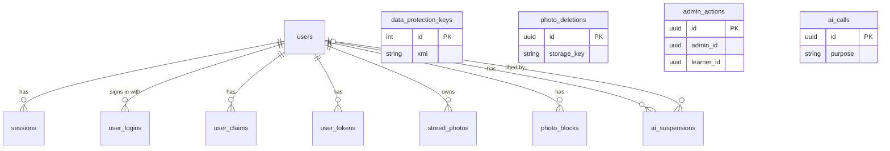
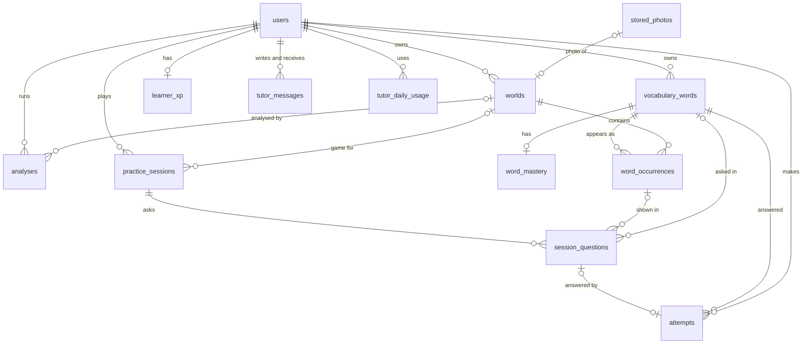

# LanguZe — Data Model (ERD and Data Dictionary)

- **Document status:** Draft v0.1 — questions raised while writing, and their decisions, are in [Appendix A](#appendix-a-questions-raised-while-writing-the-data-model)
- **Date:** 2026-09-19
- **Release covered:** Release 1.0
- **Source:** [SRS](../requirements/SRS.md) v0.10, [process flows](../flows/README.md), [architecture overview](overview.md)
- **Next documents:** API design → schema and first migration
- **Updated:** 2026-11-06, for the ASP.NET Core API: EF Core and ASP.NET Core Identity in place of Prisma and Better Auth ([ADR-0006](adr/0006-aspnet-core-api.md)). Git keeps the earlier wording

## 1. Purpose

This document defines the database for Release 1.0: every table, its columns, keys, and constraints, which module owns it, and what happens to it when a learner, world, or word is deleted. The EF Core entities and migrations in `apps/api-dotnet/LanguZe.Api/Data` implement it and are the source of truth; this document is updated with each schema change. The schema was first built by Prisma's migrations, which the `Baseline` migration still runs on an empty database, from their SQL files (ADR-0006, section 4).

## 2. Conventions

- **Names:** entities are singular PascalCase (`World`, `Data/Entities`); tables are plural snake_case (`worlds`), and columns, keys and indexes keep the snake_case names Prisma gave them (`Data/SchemaNames.cs`).
- **IDs:** every primary key is a UUID version 7, which is time-ordered for index locality and not guessable like a counter (D5). The API generates it: Npgsql's EF Core provider writes version 7 for `Guid` keys, as the rows the API creates show. The tables Identity brings with it that no one refers to keep its own keys (section 4.1).
- **Time:** timestamps are `timestamptz` in UTC (`created_at`, `updated_at`). Where a rule depends on a calendar day in `Asia/Bangkok` (V1), the day is stored as a `date`.
- **Enums:** PostgreSQL enums, mapped to C# enums (section 6).
- **Lengths:** bounded text uses `varchar(n)` with the limit from the SRS, or from V19 where the SRS sets none (D2). The API validates the same limits.
- **Deletion:** learner-owned rows reference `users` with `ON DELETE CASCADE`, so deleting an account removes all its data (FR-007). Where history must survive the deletion of a parent, the reference is `ON DELETE SET NULL`. Audit entries and photo cleanup records have no foreign key, so they outlive the account.
- **Beyond the entities:** check constraints, partial unique indexes, and the audit trigger are written as SQL in the migrations, and listed in this document.

## 3. Entity-relationship diagrams

### 3.1 Accounts, storage, moderation, and AI records

`data_protection_keys`, `photo_deletions`, `admin_actions`, and `ai_calls` have no foreign keys by design: the keys belong to the API rather than to anyone, and the other three must outlive the accounts they mention or contain no personal data.

### 3.2 Worlds, vocabulary, learning, and the tutor

## 4. Data dictionary

Types are PostgreSQL types. "Null" means the column may be empty. Every table also has the indexes implied by its primary key and unique constraints.

### 4.1 `auth` module

The tables of ASP.NET Core Identity, mapped onto the schema LanguZe already had: Identity's user is `users`, each learner keeping the ID they signed up with. Until the cutover of 2026-11-06 Better Auth's tables held the same accounts; `ReshapeAuth` moved them over and `DropBetterAuthTables` dropped what was left (ADR-0006, section 5).

**`users`:** one row per account, learner or admin (SRS 1.3).

| Column                 | Type            | Null | Notes                                                                                                                                                                                                                       |
| ---------------------- | --------------- | ---- | --------------------------------------------------------------------------------------------------------------------------------------------------------------------------------------------------------------------------- |
| `id`                   | uuid            | no   | Primary key; also the account ID shown to learners (FR-108).                                                                                                                                                                |
| `name`                 | varchar(50)     | no   | Display name, 1–50 characters (V12, V19).                                                                                                                                                                                   |
| `birth_year`           | smallint        | yes  | Year of birth given at sign-up (FR-090, V20). Empty only for a pending provider sign-up.                                                                                                                                    |
| `email`                | varchar(254)    | no   | Unique, lowercased. A placeholder ending in `.invalid` for accounts without an email address (D1).                                                                                                                          |
| `email_verified`       | boolean         | no   | Default `false`. Set by email verification or a verified provider email (FR-004, FR-009). Identity's `EmailConfirmed`.                                                                                                      |
| `user_name`            | varchar(254)    | yes  | Identity's user name, which is the email address.                                                                                                                                                                           |
| `normalized_user_name` | varchar(254)    | yes  | Upper-cased, unique; how Identity finds an account. `ReshapeAuth` filled it with PostgreSQL's `upper()`, which agrees with .NET's for ASCII only, so it refused any other address.                                          |
| `normalized_email`     | varchar(254)    | yes  | Upper-cased email. Indexed.                                                                                                                                                                                                 |
| `password_hash`        | text            | yes  | Empty for an account that signs in only through a provider, and removed when a provider joins an unverified account (U6). A hash Better Auth wrote stays until the learner's next sign-in rewrites it in Identity's format. |
| `security_stamp`       | text            | yes  | Changes when the password does, which ends every outstanding reset link.                                                                                                                                                    |
| `concurrency_stamp`    | text            | yes  | Identity's guard against two writes to one account at once.                                                                                                                                                                 |
| `image`                | text            | yes  | Left empty, since LanguZe shows no profile pictures. Kept from Better Auth's table.                                                                                                                                         |
| `role`                 | `UserRole`      | no   | Default `LEARNER`. Changed only by `promote-admins` (FR-101).                                                                                                                                                               |
| `status`               | `AccountStatus` | no   | Default `ACTIVE`. `SUSPENDED` blocks sign-in (FR-105).                                                                                                                                                                      |
| `terms_accepted_at`    | timestamptz     | yes  | Empty only for a pending provider sign-up, which is removed after 15 minutes (FR-090, U5).                                                                                                                                  |
| `created_at`           | timestamptz     | no   | Account age for the moderation record (FR-104).                                                                                                                                                                             |
| `updated_at`           | timestamptz     | no   |                                                                                                                                                                                                                             |

Verified for AI features (SRS 1.3) is not stored: it is `email_verified`, or at least one `user_logins` row for Google, LINE, or Facebook (V13, V14).

**`sessions`:** signed-in sessions (section 3 of the [authentication flow](../flows/authentication.md#3-authorizing-every-request)). The cookie carries only the row's ID, protected by Data Protection; the ticket stays here, so deleting the row ends the session at once.

| Column       | Type        | Null | Notes                                                                                         |
| ------------ | ----------- | ---- | --------------------------------------------------------------------------------------------- |
| `id`         | uuid        | no   | Primary key, named by the cookie.                                                             |
| `user_id`    | uuid        | no   | → `users`, cascade. Indexed.                                                                  |
| `ticket`     | bytea       | no   | The authentication ticket, serialized: the account and its claims, and no address or browser. |
| `expires_at` | timestamptz | no   | Seven days from issue, moved on when the session is used a day or more after it was issued.   |
| `created_at` | timestamptz | no   |                                                                                               |
| `updated_at` | timestamptz | no   |                                                                                               |

**`user_logins`:** a Google, LINE, or Facebook identity that signs in to an account.

| Column                  | Type | Null | Notes                                                             |
| ----------------------- | ---- | ---- | ----------------------------------------------------------------- |
| `login_provider`        | text | no   | `google`, `line`, or `facebook`. Primary key with `provider_key`. |
| `provider_key`          | text | no   | The provider's user ID.                                           |
| `provider_display_name` | text | yes  |                                                                   |
| `user_id`               | uuid | no   | → `users`, cascade. Indexed.                                      |

**`user_claims`** and **`user_tokens`:** Identity's tables for extra claims and for tokens kept per account. LanguZe uses neither: provider tokens are not kept (D3), and email links carry their own protected tokens rather than rows. Both reference `users` with a cascade.

**`data_protection_keys`:** the API's Data Protection keys, which protect the session cookie and email links. Each key's XML is encrypted with AES-256-GCM under `DATA_PROTECTION_KEY`, which only the environment holds, so a copy of the database cannot forge a cookie (ADR-0003). Not personal data.

Email verification and password reset links store nothing: each carries a token protected by Data Protection, which expires after an hour. A provider sign-in's state travels in its redirect and a short-lived cookie, never in a table.

### 4.2 `storage` module

**`stored_photos`:** every photo file LanguZe keeps in photo storage (FR-017).

| Column         | Type         | Null | Notes                                                  |
| -------------- | ------------ | ---- | ------------------------------------------------------ |
| `id`           | uuid         | no   | Primary key.                                           |
| `owner_id`     | uuid         | no   | → `users`, cascade. Indexed.                           |
| `storage_key`  | varchar(200) | no   | Unique. Random key of the object in photo storage.     |
| `kind`         | `PhotoKind`  | no   | `PREPARED` (at most 2,048 pixels, V18) or `THUMBNAIL`. |
| `content_type` | varchar(50)  | no   | Image type of the stored file.                         |
| `width`        | integer      | no   | Pixels.                                                |
| `height`       | integer      | no   | Pixels.                                                |
| `byte_size`    | integer      | no   |                                                        |
| `created_at`   | timestamptz  | no   |                                                        |

**`photo_deletions`:** cleanup records for photos to delete from photo storage (NFR-009). Written in the same transaction as the deletion that causes them; a scheduled task deletes the object and then the row.

| Column            | Type                  | Null | Notes                                                        |
| ----------------- | --------------------- | ---- | ------------------------------------------------------------ |
| `id`              | uuid                  | no   | Primary key.                                                 |
| `storage_key`     | varchar(200)          | no   | The object to delete. No foreign key: the owner may be gone. |
| `reason`          | `PhotoDeletionReason` | no   | Why the photo is deleted.                                    |
| `requested_at`    | timestamptz           | no   | Must be done within 24 hours of this time (V10).             |
| `attempts`        | integer               | no   | Default 0.                                                   |
| `next_attempt_at` | timestamptz           | no   | Indexed; the task picks rows whose time has come.            |
| `last_error`      | varchar(500)          | yes  | Error code or message from the last failed attempt.          |

### 4.3 `ai` module

**`ai_calls`:** metadata of every AI provider call, for reliability and cost reporting (AIR-007, NFR-017). Contains no learner identifier, photo, prompt, or message text.

| Column          | Type         | Null | Notes                                               |
| --------------- | ------------ | ---- | --------------------------------------------------- |
| `id`            | uuid         | no   | Primary key.                                        |
| `purpose`       | `AiPurpose`  | no   | `SAFETY_CHECK`, `EXTRACTION`, or `TUTOR`.           |
| `provider`      | varchar(50)  | no   |                                                     |
| `model`         | varchar(100) | no   |                                                     |
| `started_at`    | timestamptz  | no   | Indexed.                                            |
| `latency_ms`    | integer      | no   |                                                     |
| `input_tokens`  | integer      | yes  | When the provider reports it.                       |
| `output_tokens` | integer      | yes  | When the provider reports it.                       |
| `outcome`       | `AiOutcome`  | no   |                                                     |
| `error_code`    | varchar(100) | yes  |                                                     |
| `request_id`    | varchar(100) | yes  | Links the call to the API's request logs (NFR-016). |

### 4.4 `worlds` module

**`worlds`** (FR-010–FR-017, FR-021):

| Column           | Type              | Null | Notes                                                                         |
| ---------------- | ----------------- | ---- | ----------------------------------------------------------------------------- |
| `id`             | uuid              | no   | Primary key.                                                                  |
| `learner_id`     | uuid              | no   | → `users`, cascade.                                                           |
| `name`           | varchar(50)       | no   | 1–50 characters (V3).                                                         |
| `status`         | `WorldStatus`     | no   | `ANALYZING`, `READY`, or `FAILED`.                                            |
| `failure_reason` | `AnalysisFailure` | yes  | Set when `FAILED`; decides the message and whether retry is offered.          |
| `photo_id`       | uuid              | yes  | → `stored_photos`, set null. Empty after a blocked photo is deleted (FR-092). |
| `thumbnail_id`   | uuid              | yes  | → `stored_photos`, set null.                                                  |
| `created_at`     | timestamptz       | no   | "Most recently created world" for review questions (FR-051).                  |
| `updated_at`     | timestamptz       | no   |                                                                               |

Index: (`learner_id`, `created_at`). Word counts and mastered-word counts on the world list (FR-013) are computed by query.

**`analyses`:** one row per analysis run, used for the daily limit (FR-020, U2).

| Column           | Type              | Null | Notes                                                                         |
| ---------------- | ----------------- | ---- | ----------------------------------------------------------------------------- |
| `id`             | uuid              | no   | Primary key.                                                                  |
| `learner_id`     | uuid              | no   | → `users`, cascade.                                                           |
| `world_id`       | uuid              | yes  | → `worlds`, **set null**, so deleting a world cannot give back used analyses. |
| `status`         | `AnalysisStatus`  | no   | `IN_PROGRESS`, `SUCCEEDED`, `BLOCKED`, or `FAILED`.                           |
| `failure_reason` | `AnalysisFailure` | yes  | Set when `FAILED` or `BLOCKED`.                                               |
| `started_at`     | timestamptz       | no   |                                                                               |
| `finished_at`    | timestamptz       | yes  |                                                                               |

Indexes: (`learner_id`, `started_at`) for the daily count; (`status`, `started_at`) for the 5-minute rule (V16). The daily count is the number of the learner's analyses started since midnight `Asia/Bangkok` with status `IN_PROGRESS`, `SUCCEEDED`, or `BLOCKED`. It is checked under a transaction-scoped advisory lock for the learner, so parallel uploads cannot both take the last analysis.

### 4.5 `vocabulary` module

**`vocabulary_words`:** a learner's word, one per English word (FR-043). The games ask for the English, so one English word is one word with one mastery, whatever Thai meaning each photo gave it. Until 2026-11-07 a word was its English and its Thai meaning together, so a model that answered กาต้มน้ำ in one photo and กาน้ำร้อน in another gave the learner two words; `WordsByEnglish` merged them into the oldest, moving each photo's meaning to its occurrence first (#72).

| Column         | Type         | Null | Notes                                                                                       |
| -------------- | ------------ | ---- | ------------------------------------------------------------------------------------------- |
| `id`           | uuid         | no   | Primary key.                                                                                |
| `learner_id`   | uuid         | no   | → `users`, cascade.                                                                         |
| `english`      | varchar(40)  | no   | Normalized English word in singular base form (SRS 4.2, AIR-003); also displayed.           |
| `thai_meaning` | varchar(100) | no   | The Thai meaning of its first occurrence, for the places that show no photo (V19, SRS 2.4). |
| `created_at`   | timestamptz  | no   |                                                                                             |

Unique: (`learner_id`, `english`). A word is deleted, with its mastery and attempts, when its last occurrence is removed (FR-015, FR-027).

**`word_occurrences`:** a word in one world's photo (SRS 1.3).

| Column               | Type             | Null | Notes                                                                                         |
| -------------------- | ---------------- | ---- | --------------------------------------------------------------------------------------------- |
| `id`                 | uuid             | no   | Primary key.                                                                                  |
| `world_id`           | uuid             | no   | → `worlds`, cascade.                                                                          |
| `vocabulary_word_id` | uuid             | no   | → `vocabulary_words`, cascade. Indexed.                                                       |
| `thai_meaning`       | varchar(100)     | no   | The Thai meaning the analysis gave the word in this photo, shown in this world (FR-043, V19). |
| `box_x`              | double precision | no   | Highlight box, relative to the prepared photo (0–1).                                          |
| `box_y`              | double precision | no   |                                                                                               |
| `box_width`          | double precision | no   |                                                                                               |
| `box_height`         | double precision | no   |                                                                                               |
| `point_x`            | double precision | yes  | Where the question's arrow points, on the object, relative to the prepared photo (0–1; #73).  |
| `point_y`            | double precision | yes  |                                                                                               |
| `tail_x`             | double precision | yes  | Where the arrow starts, on a plain part of the photo; the question's number sits there.       |
| `tail_y`             | double precision | yes  |                                                                                               |
| `point_source`       | `PointSource`    | yes  | `MODEL`, `BOX_CENTRE` or `FREE_SPOT`: where the spot came from (ADR-0004).                    |
| `example_sentence`   | varchar(200)     | no   | A1–B1 English containing the word or a variant (AIR-003, AIR-005, V19).                       |
| `cefr_level`         | `CefrLevel`      | no   |                                                                                               |
| `accepted_variants`  | varchar(40)[]    | no   | Normalized, unique, at most 10 (AIR-003, V19). The word itself is not repeated.               |
| `created_at`         | timestamptz      | no   |                                                                                               |

Unique: (`world_id`, `vocabulary_word_id`), because duplicates within a photo are merged (AIR-004). Check constraints: the box lies inside 0–1 with a width and height above 0 (AIR-003); the arrow columns are all empty or all set, inside 0–1. Worlds analysed before the arrow have none, and their questions show the box alone. A `READY` world has 3–12 occurrences when its analysis finishes (FR-024), enforced by the API; the learner may later remove words down to one (FR-026).

**`closed_accounts`** (users; FR-111, ADR-0007). What identifies an account after it is deleted, written in the deletion's transaction and kept 90 days, as the Computer Crime Act requires (s.26 paragraph 2). Everything else the learner had goes at once (FR-007).

| Column               | Type           | Null | Notes                                                                           |
| -------------------- | -------------- | ---- | ------------------------------------------------------------------------------- |
| `account_id`         | uuid           | no   | Primary key; the deleted account's ID. No foreign key: it outlives the account. |
| `email`              | varchar(254)   | yes  | Empty when the account had none, or only a placeholder (D1).                    |
| `provider_accounts`  | varchar(300)[] | no   | Each linked sign-in as `provider:key`, such as `line:U1234…`.                   |
| `account_created_at` | timestamptz    | no   |                                                                                 |
| `closed_at`          | timestamptz    | no   | Indexed. The record is deleted 90 days after it, by the database's clock.       |
| `closed_by_admin`    | boolean        | no   | Whether an admin deleted the account (FR-105) rather than the learner (FR-007). |

Two triggers refuse every UPDATE and TRUNCATE, and any DELETE before the 90 days are up, so neither a bug nor a stray query can shorten the time the law sets. A job deletes each record when its 90 days are up, reading the database only when one is due.

**`traffic_events`** (platform; FR-110, ADR-0007). The traffic data the Computer Crime Act requires for 90 days (s.26 paragraph 1): one row per sign-up, sign-in, failed sign-in, sign-out, photo upload, tutor message, or account deletion. Each is written in the request it records, in the same transaction where the action has one, and a failure to write it fails the request. Not every request is logged.

| Column        | Type                 | Null | Notes                                                                                                                                                                                                               |
| ------------- | -------------------- | ---- | ------------------------------------------------------------------------------------------------------------------------------------------------------------------------------------------------------------------- |
| `id`          | uuid                 | no   | Primary key.                                                                                                                                                                                                        |
| `kind`        | `traffic_event_kind` | no   | `SIGN_UP`, `SIGN_IN`, `SIGN_IN_FAILED`, `SIGN_OUT`, `PHOTO_UPLOAD`, `TUTOR_MESSAGE`, or `ACCOUNT_DELETED`.                                                                                                          |
| `account_id`  | uuid                 | yes  | Indexed. Empty for a failed sign-in to an address no account has; the address typed is never kept. No foreign key: it outlives the account.                                                                         |
| `via`         | varchar(20)          | yes  | For a sign-up or sign-in: `password`, `google`, `line`, or `facebook`.                                                                                                                                              |
| `ip`          | inet                 | yes  | The caller's address: Cloudflare's `CF-Connecting-IP` behind Cloudflare, otherwise `X-Forwarded-For` within `TRUST_PROXY_HOPS` (API design, section 5). The first events, on 2026-11-07, hold Cloudflare's address. |
| `occurred_at` | timestamptz          | no   | Indexed.                                                                                                                                                                                                            |

The same two triggers as `closed_accounts` keep each row unchanged for 90 days. A job deletes rows past 90 days, at most once a day, reading the database only when one is due.

### 4.6 `learning` module

**`word_mastery`** (FR-040, FR-041, SRS 4.1). No row means `NEW`: the row is created by the first attempt, so extraction does not write learning data.

| Column               | Type           | Null | Notes                                                                 |
| -------------------- | -------------- | ---- | --------------------------------------------------------------------- |
| `vocabulary_word_id` | uuid           | no   | Primary key; → `vocabulary_words`, cascade.                           |
| `learner_id`         | uuid           | no   | → `users`, cascade. Copied from the word for queries by learner.      |
| `level`              | `MasteryLevel` | no   | `LEARNING`, `FAMILIAR`, or `MASTERED`; `NEW` is the absence of a row. |
| `streak`             | smallint       | no   | Correct-answer streak (SRS 4.1).                                      |
| `familiar_on`        | date           | yes  | The `Asia/Bangkok` day the word last became `FAMILIAR`.               |
| `last_practised_at`  | timestamptz    | no   | For "least recently practised first" (FR-050).                        |
| `updated_at`         | timestamptz    | no   |                                                                       |

Index: (`learner_id`, `level`). Check constraint: the streak is not negative.

**`practice_sessions`:** game and review sessions (FR-030, FR-036, FR-050).

| Column         | Type            | Null | Notes                                                                     |
| -------------- | --------------- | ---- | ------------------------------------------------------------------------- |
| `id`           | uuid            | no   | Primary key.                                                              |
| `learner_id`   | uuid            | no   | → `users`, cascade.                                                       |
| `kind`         | `SessionKind`   | no   | `GAME` or `REVIEW`.                                                       |
| `world_id`     | uuid            | yes  | → `worlds`, set null. Set for games only.                                 |
| `status`       | `SessionStatus` | no   | `IN_PROGRESS`, `COMPLETED`, or `ABANDONED`.                               |
| `started_at`   | timestamptz     | no   | An `IN_PROGRESS` session older than 24 hours counts as `ABANDONED` (V17). |
| `completed_at` | timestamptz     | yes  |                                                                           |

Index: (`learner_id`, `started_at`). Partial unique indexes: one `IN_PROGRESS` game per learner and world, and one `IN_PROGRESS` review per learner. Starting a new session first marks the old one `ABANDONED` in the same transaction; the indexes are what keep two sessions from existing if two requests arrive together. A game whose world was deleted keeps an empty `world_id`, which the index treats as distinct, so those closed-off sessions constrain nothing.

**`session_questions`:** the ordered questions of a session, fixed when it is created.

| Column               | Type     | Null | Notes                                                                |
| -------------------- | -------- | ---- | -------------------------------------------------------------------- |
| `id`                 | uuid     | no   | Primary key.                                                         |
| `session_id`         | uuid     | no   | → `practice_sessions`, cascade.                                      |
| `position`           | smallint | no   | 1–10. Unique with `session_id`; a check keeps it at 1 or above.      |
| `vocabulary_word_id` | uuid     | yes  | → `vocabulary_words`, set null.                                      |
| `occurrence_id`      | uuid     | yes  | → `word_occurrences`, set null. When empty, the question is skipped. |

**`attempts`:** every answer (FR-034); an incorrect attempt is a mistake (FR-042).

| Column               | Type           | Null | Notes                                                                                        |
| -------------------- | -------------- | ---- | -------------------------------------------------------------------------------------------- |
| `id`                 | uuid           | no   | Primary key.                                                                                 |
| `learner_id`         | uuid           | no   | → `users`, cascade.                                                                          |
| `vocabulary_word_id` | uuid           | no   | → `vocabulary_words`, cascade, so mistakes stay while the word exists in any world (FR-015). |
| `question_id`        | uuid           | yes  | → `session_questions`, set null. **Unique**: one attempt per question (FR-034, S5).          |
| `session_id`         | uuid           | yes  | → `practice_sessions`, set null (FR-034).                                                    |
| `occurrence_id`      | uuid           | yes  | → `word_occurrences`, set null (FR-034).                                                     |
| `answer_text`        | varchar(100)   | yes  | What the learner typed; empty for "I don't know" (FR-032, V19).                              |
| `is_dont_know`       | boolean        | no   |                                                                                              |
| `is_correct`         | boolean        | no   |                                                                                              |
| `xp_awarded`         | smallint       | no   | 10 or 0 (FR-060).                                                                            |
| `level_before`       | `MasteryLevel` | yes  | Where the word stood before this answer; empty means it was `NEW`.                           |
| `level_after`        | `MasteryLevel` | no   | And where it stands after.                                                                   |
| `answered_at`        | timestamptz    | no   |                                                                                              |

The two level columns are kept because a session's summary has to name the words whose level changed (FR-035), and nothing can work that out afterwards: `word_mastery` holds only where a word stands now, which by the end of a session is where it ended rather than where it began.

Indexes: (`learner_id`, `answered_at`) for recent mistakes; (`vocabulary_word_id`, `answered_at`). Check constraints: an "I don't know" attempt has no answer text and is not correct; XP is never negative, and an incorrect attempt earns none (FR-033, V4).

**`learner_xp`:** total XP, stored so it never decreases when attempts are deleted (FR-060, V4).

| Column       | Type        | Null | Notes                                                           |
| ------------ | ----------- | ---- | --------------------------------------------------------------- |
| `learner_id` | uuid        | no   | Primary key; → `users`, cascade.                                |
| `total_xp`   | integer     | no   | Default 0. Only ever increased; a check keeps it at 0 or above. |
| `updated_at` | timestamptz | no   |                                                                 |

### 4.7 `tutor` module

**`tutor_messages`:** the learner's single conversation (FR-070, V6).

| Column       | Type        | Null | Notes                                               |
| ------------ | ----------- | ---- | --------------------------------------------------- |
| `id`         | uuid        | no   | Primary key.                                        |
| `learner_id` | uuid        | no   | → `users`, cascade.                                 |
| `role`       | `TutorRole` | no   | `LEARNER` or `TUTOR`.                               |
| `content`    | text        | no   | Learner messages are at most 1,000 characters (V7). |
| `created_at` | timestamptz | no   |                                                     |

Index: (`learner_id`, `created_at`). Clearing the conversation deletes these rows only (FR-076).

Check constraint: no message is empty, and a learner's is at most 1,000 characters (V7). A tutor reply is not capped, because the tutor decides how much an explanation needs. The API checks the same rule at the boundary; the constraint keeps it true whatever writes the row.

The two rows of one exchange are written with explicit times a millisecond apart: `CURRENT_TIMESTAMP` is the start of the transaction, so both would otherwise carry one instant and the conversation would have no order to be read back in.

**`tutor_daily_usage`:** messages used per learner per day (FR-071, S6).

| Column          | Type        | Null | Notes                                       |
| --------------- | ----------- | ---- | ------------------------------------------- |
| `learner_id`    | uuid        | no   | → `users`, cascade. Primary key with `day`. |
| `day`           | date        | no   | `Asia/Bangkok` day (V1).                    |
| `messages_used` | smallint    | no   | Default 0.                                  |
| `updated_at`    | timestamptz | no   |                                             |

A message is reserved with one conditional update that increments `messages_used` only while it is below the limit, and released by decrementing it if the provider fails, so no explicit lock is needed: two messages sent at the same moment serialise on the row itself. This is what `analyses` cannot do, because its daily count is a number of rows rather than a column, leaving it nothing to lock (section 4.4). The day is sent as its own text rather than as an instant, so no server's time zone can move it (V1).

### 4.8 `moderation` module

**`photo_blocks`** (FR-095): never the photo itself.

| Column       | Type            | Null | Notes                                       |
| ------------ | --------------- | ---- | ------------------------------------------- |
| `id`         | uuid            | no   | Primary key.                                |
| `learner_id` | uuid            | no   | → `users`, cascade.                         |
| `category`   | `BlockCategory` | no   | The FR-091 category the safety check found. |
| `created_at` | timestamptz     | no   |                                             |

Index: (`learner_id`, `created_at`) for "3 blocked photos within 7 days" (V15).

**`ai_suspensions`** (FR-096, FR-098, V15):

| Column       | Type               | Null | Notes                                                           |
| ------------ | ------------------ | ---- | --------------------------------------------------------------- |
| `id`         | uuid               | no   | Primary key.                                                    |
| `learner_id` | uuid               | no   | → `users`, cascade.                                             |
| `reason`     | `SuspensionReason` | no   |                                                                 |
| `starts_at`  | timestamptz        | no   | Queue order, oldest first (FR-103).                             |
| `ends_at`    | timestamptz        | yes  | Empty means "until an admin reviews". Set or moved by an admin. |
| `lifted_at`  | timestamptz        | yes  | Set when an admin lifts the suspension.                         |
| `lifted_by`  | uuid               | yes  | → `users`, set null. The admin who lifted it.                   |
| `created_at` | timestamptz        | no   |                                                                 |
| `updated_at` | timestamptz        | no   |                                                                 |

Index: (`learner_id`, `starts_at`). A learner's current suspension is the latest one that is not lifted and whose end time is empty or in the future; it awaits review when its end time is empty. The review queue lists active accounts whose current suspension awaits review (FR-103, U4).

Check constraints: an end time must come after the start; a lift must carry a time, because `lifted_by` becomes empty once that admin's account is deleted; and a lift cannot predate the start.

**`admin_actions`:** the audit log (FR-106).

| Column       | Type              | Null | Notes                                                                                   |
| ------------ | ----------------- | ---- | --------------------------------------------------------------------------------------- |
| `id`         | uuid              | no   | Primary key.                                                                            |
| `admin_id`   | uuid              | no   | No foreign key, so the entry outlives the admin's account.                              |
| `learner_id` | uuid              | no   | No foreign key, so the entry outlives the learner's account (FR-106).                   |
| `action`     | `AdminActionType` | no   |                                                                                         |
| `reason`     | varchar(500)      | no   | 1–500 characters (FR-105, V19).                                                         |
| `details`    | jsonb             | yes  | For `SET_AI_SUSPENSION_END`, the new end date and the one it replaced; empty otherwise. |
| `created_at` | timestamptz       | no   | Indexed; the log is shown newest first.                                                 |

Index also on `learner_id`. Database triggers reject every update and delete (D4), and a check constraint rejects a reason that is empty or only whitespace (FR-105, V19).

There are two triggers, because one cannot do it: `UPDATE` and `DELETE` fire per row, while `TRUNCATE` fires per statement and would otherwise walk straight past a row trigger and empty the whole log. The error keeps PostgreSQL's default code for a raised exception; a more descriptive code such as `restrict_violation` sits in SQLSTATE class 23, which Prisma, the NestJS API's ORM, reported as "Foreign key constraint violated", dropping the message with it.

### 4.9 Tables written by another module

The module a table is listed under above owns it, and the API keeps that as its map of ownership (ADR-0006, section 1). Every module may read any table, through the one database context. Writing another module's table is the exception, and these are all of them, found in the NestJS code on 2026-10-28 and kept by the port:

| Writer     | Table (owner)                                       | Why                                                                     |
| ---------- | --------------------------------------------------- | ----------------------------------------------------------------------- |
| moderation | `users` (auth): update; `sessions` (auth): delete   | Suspending an account sets its status and ends its sessions (FR-105)    |
| users      | `users` (auth): delete; `photo_deletions` (storage) | Deleting an account (FR-007, section 5)                                 |
| worlds     | `stored_photos`, `photo_deletions` (storage)        | Storing a world's photo, and queuing it for deletion with the world     |
| worlds     | `vocabulary_words`, `word_occurrences` (vocabulary) | The analysis saves the words; vocabulary holds only rules, no endpoints |
| worlds     | `photo_blocks` (moderation)                         | A photo the safety check blocks is recorded for review (FR-092)         |

A new write across owners is a decision to explain in its pull request, and belongs in this table. If a module ever leaves the monolith, these rows are the places that turn into calls or events.

## 5. What happens on deletion

| Deleted                   | Effect                                                                                                                                                                                                                                                                                                                                                                                                                                                                                                                       |
| ------------------------- | ---------------------------------------------------------------------------------------------------------------------------------------------------------------------------------------------------------------------------------------------------------------------------------------------------------------------------------------------------------------------------------------------------------------------------------------------------------------------------------------------------------------------------- |
| Account (`users` row)     | Cascades to every learner-owned table. In the same transaction, the API writes `photo_deletions` for the learner's `stored_photos`. Its sessions and provider identities go with the cascade, and an unused reset link stops working, since it names an account that no longer exists. `admin_actions` stay, with IDs only; `ai_suspensions.lifted_by` of other learners becomes empty. The account row is locked before the photos are read, so a photo stored in between cannot be cascaded away without a cleanup record. |
| World                     | Cascades to its `word_occurrences`. The API deletes words left without occurrences (cascading to their mastery and attempts), deletes the world's `stored_photos` rows, and writes `photo_deletions`. `analyses`, `practice_sessions`, and `session_questions` keep their rows with the links cleared.                                                                                                                                                                                                                       |
| Word removed from a world | The occurrence is deleted; if it was the word's last occurrence, the word is deleted too, as for a world.                                                                                                                                                                                                                                                                                                                                                                                                                    |
| Blocked photo             | The `stored_photos` rows are deleted and `photo_deletions` written; the world keeps its row with `photo_id` empty.                                                                                                                                                                                                                                                                                                                                                                                                           |
| Tutor conversation        | Deletes `tutor_messages` only; `tutor_daily_usage` stays.                                                                                                                                                                                                                                                                                                                                                                                                                                                                    |

## 6. Enums

| Enum                  | Values                                                                                                                                                                                                                            |
| --------------------- | --------------------------------------------------------------------------------------------------------------------------------------------------------------------------------------------------------------------------------- |
| `UserRole`            | `LEARNER`, `ADMIN`                                                                                                                                                                                                                |
| `AccountStatus`       | `ACTIVE`, `SUSPENDED`                                                                                                                                                                                                             |
| `PhotoKind`           | `PREPARED`, `THUMBNAIL`                                                                                                                                                                                                           |
| `PhotoDeletionReason` | `WORLD_DELETED`, `ACCOUNT_DELETED`, `PHOTO_BLOCKED`, `UPLOAD_FAILED`                                                                                                                                                              |
| `AiPurpose`           | `SAFETY_CHECK`, `EXTRACTION`, `TUTOR`                                                                                                                                                                                             |
| `AiOutcome`           | `SUCCEEDED`, `FAILED`, `TIMED_OUT`, `INVALID_OUTPUT`                                                                                                                                                                              |
| `WorldStatus`         | `ANALYZING`, `READY`, `FAILED`                                                                                                                                                                                                    |
| `AnalysisStatus`      | `IN_PROGRESS`, `SUCCEEDED`, `BLOCKED`, `FAILED`                                                                                                                                                                                   |
| `AnalysisFailure`     | `BLOCKED`, `TOO_FEW_WORDS`, `PROVIDER_ERROR`, `INVALID_OUTPUT`, `TIMED_OUT`                                                                                                                                                       |
| `CefrLevel`           | `A1`, `A2`, `B1`, `B2`, `C1`, `C2`                                                                                                                                                                                                |
| `PointSource`         | `MODEL`, `BOX_CENTRE`, `FREE_SPOT` (#73)                                                                                                                                                                                          |
| `MasteryLevel`        | `LEARNING`, `FAMILIAR`, `MASTERED` (`NEW` is the absence of a row)                                                                                                                                                                |
| `SessionKind`         | `GAME`, `REVIEW`                                                                                                                                                                                                                  |
| `SessionStatus`       | `IN_PROGRESS`, `COMPLETED`, `ABANDONED`                                                                                                                                                                                           |
| `TutorRole`           | `LEARNER`, `TUTOR`                                                                                                                                                                                                                |
| `BlockCategory`       | `SEXUAL_CONTENT`, `SUSPECTED_ILLEGAL_MATERIAL` (suspected sexual content involving minors only), `VIOLENCE`, `ILLEGAL_ACTIVITY` (including illicit drugs/controlled substances), `HATE_SYMBOL`, `PERSONAL_DATA`, `OTHER` (FR-091) |
| `SuspensionReason`    | `REPEATED_BLOCKS` (level 1), `REPEATED_AFTER_SUSPENSION` (level 2), `SUSPECTED_ILLEGAL_MATERIAL` (FR-098)                                                                                                                         |
| `AdminActionType`     | `LIFT_AI_SUSPENSION`, `SET_AI_SUSPENSION_END`, `SUSPEND_ACCOUNT`, `REACTIVATE_ACCOUNT`, `DELETE_ACCOUNT`                                                                                                                          |

## 7. Personal data

For the Privacy Policy and PDPA requests, this is where personal data lives and how it is removed. A learner deletes everything themselves with `DELETE /v1/me`, which removes the `users` row; every table below with a foreign key to it is removed by the cascade in the same statement.

| Data                                       | Where                                        | Removed                                                            |
| ------------------------------------------ | -------------------------------------------- | ------------------------------------------------------------------ |
| Email address, display name, year of birth | `users`                                      | With the account.                                                  |
| Sign-in identities at providers            | `user_logins.provider_key`                   | With the account.                                                  |
| Sessions                                   | `sessions`, which hold no address or browser | With the session or the account.                                   |
| Photos of the learner's surroundings       | Photo storage, referenced by `stored_photos` | Within 24 hours of the world or account deletion (V10).            |
| World names, words, answers, mistakes      | `worlds`, `vocabulary_words`, `attempts`     | With the world, the word, or the account.                          |
| Tutor conversation                         | `tutor_messages`                             | When cleared, or with the account.                                 |
| Moderation history                         | `photo_blocks`, `ai_suspensions`             | With the account (U8).                                             |
| Account identifiers in the audit log       | `admin_actions`                              | Kept by design (FR-106); IDs only, no other personal data.         |
| Traffic data: events, account, IP address  | `traffic_events`                             | 90 days after the event, whatever happens to the account (FR-110). |
| What identifies a deleted account          | `closed_accounts`                            | 90 days after the deletion (FR-111).                               |

`ai_calls` and `photo_deletions` contain no personal data.

## Appendix A. Questions raised while writing the data model

| ID  | Question                                                                                                                            | Decision                                                                                                                                                                                                                                                                                                                                                                                                                                                                                                    | Affects                                   | Status               |
| --- | ----------------------------------------------------------------------------------------------------------------------------------- | ----------------------------------------------------------------------------------------------------------------------------------------------------------------------------------------------------------------------------------------------------------------------------------------------------------------------------------------------------------------------------------------------------------------------------------------------------------------------------------------------------------- | ----------------------------------------- | -------------------- |
| D1  | Better Auth requires an email address on every account, but LINE and Facebook accounts may have none (FR-009). How are they stored? | Follow Better Auth's documented approach: give such accounts a placeholder address built from the provider and the provider's user ID, on the reserved `.invalid` domain, for example `line.U1234@no-email.languze.invalid`. The `.invalid` domain can never receive mail. The API treats any address ending in `.invalid` as "no email address": it never sends email to it, offers no password reset, never shows it to the learner, and admin search finds such learners by account ID instead (FR-108). | `users.email`; auth configuration; FR-009 | Confirmed 2026-09-19 |
| D2  | The SRS sets no length for some stored text. What limits apply?                                                                     | Display name 1–50 characters; Thai meaning 1–100; example sentence up to 200; at most 10 accepted variants per word, each up to 40 like the word itself; typed answer up to 100; admin reason 1–500. Recorded in SRS v0.9 as V19.                                                                                                                                                                                                                                                                           | Column types; API validation; SRS         | Confirmed 2026-09-19 |
| D3  | Better Auth can store the access, refresh, and ID tokens returned by Google, LINE, and Facebook. Should LanguZe keep them?          | No. LanguZe never calls those providers after sign-in, so a stolen database would hand an attacker working tokens for nothing. A Better Auth database hook cleared the token fields before they were saved. Since 2026-11-06 the ASP.NET Core handlers do not save them at all, and `user_tokens` stays empty.                                                                                                                                                                                              | `auth_accounts`; Better Auth ADR          | Confirmed 2026-09-19 |
| D4  | FR-106 forbids editing or deleting audit entries through the application. Should the database enforce it too?                       | Yes. A trigger on `admin_actions` rejects every update and delete, so not even a bug or a manual query can change the audit log. Inserts still work, and the trigger is part of the migration.                                                                                                                                                                                                                                                                                                              | `admin_actions`; migration                | Confirmed 2026-09-19 |
| D5  | Which kind of primary key?                                                                                                          | UUID version 7 for every table, generated by Prisma, with Better Auth configured to leave ID generation to Prisma; since 2026-11-06 by Npgsql's EF Core provider, which writes version 7 for `Guid` keys. Version 7 UUIDs are ordered by time, which keeps indexes compact, and unlike counters they reveal nothing about how many accounts or worlds exist.                                                                                                                                                | All tables                                | Confirmed 2026-09-19 |
