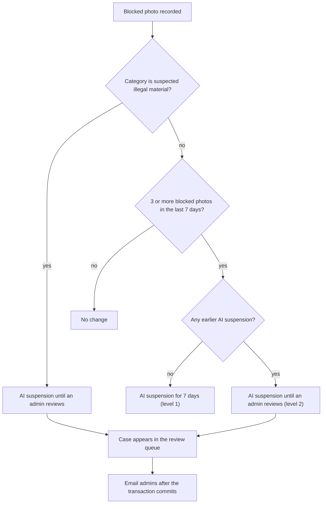
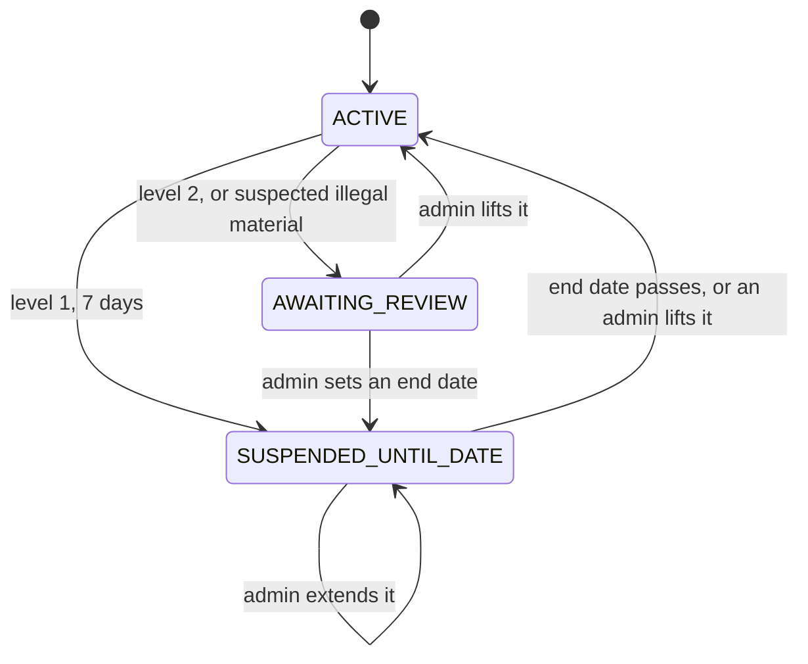
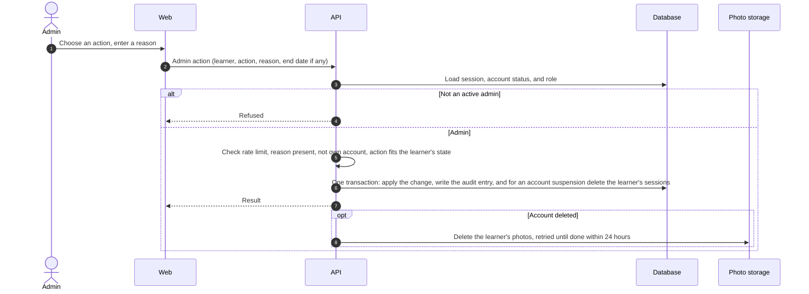

# Moderation flow

- **Use cases:** UC-090, UC-101, UC-102, UC-103
- **Requirements:** FR-095–FR-098, FR-100–FR-108, NFR-019, V15

## 1. After a blocked photo (UC-090)

The suspension check runs inside the transaction that records the blocked photo ([Image to vocabulary, section 2](image-to-vocabulary.md#2-analyse-the-photo-uc-020)):

- A suspension is its own record with a start time, a reason, and an end time; an empty end time means "until an admin reviews". Every suspension stays in the learner's history until the account is deleted (FR-104, U8).
- The notification email says only that a case needs review and links to the queue. It contains no learner data (FR-107), not even an account identifier: it may be read on a shared screen or forwarded, and which case it is belongs behind a sign-in.
- It goes to every active `ADMIN` account, or to `ADMIN_ALERT_EMAIL` while there are none, because admins are promoted by a deployment script that may not have run yet. With neither, the API logs an error; a case waiting in a queue nobody has been told about is what FR-107 exists to prevent.
- Only a suspension awaiting review earns an email. A level 1 suspension ends by itself, so nobody has to act on it, and mail that needs no action teaches admins to ignore mail that does.

## 2. AI suspension status of a learner

- `ACTIVE` means AI features are available. The status is worked out from the learner's suspension records when needed; an end date that has passed needs no background job.
- While a learner is not `ACTIVE`, photo analysis and the tutor are refused ([Authentication, section 3](authentication.md#3-authorizing-every-request)); everything else works (FR-096).

## 3. Admin action (UC-103)

- The change and its audit entry (admin, learner, action, reason, time) are saved in the same transaction, so there is never a change without an entry (FR-106).
- Deleting the learner's sessions in the same transaction makes an account suspension take effect immediately (FR-105).
- An account deletion by an admin removes the same data as the learner's own deletion ([Authentication, section 5](authentication.md#5-sign-out-and-account-deletion-uc-002-uc-005)). The two share one function, so they cannot drift apart; only signing a browser out is left to the learner's own request, since an admin deleting someone else's account must not be signed out by it.
- The learner's account row is locked for the length of an action. Whether an action fits is decided from what is read, and two admins acting on the same case at once would otherwise both pass the check — reactivating an active account twice, say, leaving the audit log claiming two changes where there was one.
- Lifting a suspension, or giving it an end date, applies to every suspension in force rather than only the latest. A learner can hold an older suspension still awaiting review behind a newer one; acting on the newer alone would leave the older one keeping AI features off, when US-104 says a lift gives them back at once.
- Giving an end date records the end it replaced in the audit entry's details, because the suspension itself only remembers the new one.

## 4. Review queue and learner search (UC-101, UC-102)

- **Queue (FR-103):** learners whose account is active and whose current AI suspension awaits review, oldest first, with their block counts and categories. A reactivated account whose suspension still awaits review appears again automatically, because the queue is worked out from the current state rather than stored separately (U4).
- Which suspension counts is the same question the learner's own AI access asks: the latest one not lifted and not yet ended. A learner holding an old suspension that still awaits review and a newer one with an end date is under the newer one, so they are not in the queue — their AI comes back on its own.
- A case carries the account ID and nothing else personal: the reason, when the pause began, and the blocks counted by category. A list is read at a glance and over shoulders, and the moderation record is one request away (FR-104).
- The queue is not paged. It is a work list meant to be emptied, and one long enough to need paging is itself the thing to deal with.
- **Search (FR-108):** an exact email address or account ID returns at most one learner. There is no partial search and no list of all learners.
- An address is lowercased and trimmed, then matched exactly against the unique index. Every address the application stores is lowercased on the way in — Better Auth does it at sign-up, and placeholders are built that way — so this finds anyone who signed up and can never find two of them. For a lookup that hands over a person's record, one certain answer is worth more than a forgiving one.
- A placeholder address finds nothing, even when an account holds it. Nobody writes from one, and it is built from the provider's own user ID, so searching by it would only be a way of probing those IDs (D1). Such learners are found by account ID, which they can read in their account settings.
- **Moderation record (FR-104):** block records, AI suspension history, account age, and sign-in methods. The API never returns photos or tutor messages to the admin area.
- Nor does it return the learner's name or email address. The admin found them by an address or an ID they already hold, so the record has no need to repeat either, and it may be on screen while someone else is in the room.
- What the record holds is fixed by the database query itself, which names every column it reads and no others. Photos, worlds, words, tutor messages, the name and the address are never fetched, rather than fetched and then left out, where a later change could forget to.

### In the web app (FR-102, FR-105)

- The admin area lives under `/admin`: the review queue, search, a learner's record, and the audit log. The home page links to it only for an admin.
- Anyone else who opens an admin page — a learner, or someone signed out — gets the ordinary "not found" page, never a sign-in prompt or "not allowed". A prompt to sign in would confirm what the 404 is there to hide. This is where the web app parts from the API, which answers someone signed out with `NOT_SIGNED_IN` because it resolves the session before it looks at the role ([Authentication, section 3](authentication.md#3-authorizing-every-request)).
- The check runs in the admin layout as well as in each page. A page's own check alone would still show the admin navigation around its "not found"; and the layout is not run again as an admin moves between pages, which is why each page checks too. None of this is the guard — the API refuses every admin request from anyone else — it decides only what a page shows.
- An admin page's title is worked out per request, and only for an admin. A page's metadata is resolved apart from the page itself, so a fixed title goes out even over the "not found" a non-admin is answered with — the browser tab would name the page it is hiding. With this, the head of an admin page asked for by anyone else carries the same title and the same `noindex` as that of a page that does not exist.
- One difference remains, in the page source only. A route that does not exist sends its "404" text and title in the HTML itself; an existing route that answered "not found" sends them only in the data the browser draws the page from. The browser shows both the same, tab title included. Every page that refuses this way differs like this — a world belonging to someone else does too — and removing it would mean checking the role before Next.js even matches a route. It says that something is mounted at `/admin`; it shows nothing that is there. A development server also marks such a page with `<meta name="next-error">`, and writes the error's stack into it ([Local development](../deployment/local-development.md#testing-through-the-tunnel)); a production build does neither, checked by fetching an admin page from one signed out.
- Search sends what the admin typed to the API from the browser, then opens the record by its account ID. An email address typed into it therefore never reaches a page address, where the browser's history would keep it. The API leaves query strings out of its own logs for the same reason.
- Acting on a case happens at the foot of the learner's record, after everything it should be judged on. Only the actions that fit the learner's state are offered: lifting or ending a suspension while one is in force, suspending an active account or reactivating a suspended one, and deleting always. That is the API's own rule, and the API keeps the last word: when another admin acted first it answers `ACTION_NOT_APPLICABLE`, and the page says so, keeps the reason written, and shows the record again.
- An end date is chosen as a day, and AI features come back as that day starts on Bangkok time (00:00, +07:00). An admin thinks of a suspension in days, and "back on the 12th" should not leave the learner waiting until some hour of it. The earliest day offered is tomorrow; should the day turn while the form is open, the API refuses the date and the page asks for a later one.
- Deleting asks a second time, as a learner's own deletion does, since nothing undoes it. Afterwards the admin goes back to the review queue: there is no record left to show.
- On an admin's own record the form gives way to a note. The API refuses those actions anyway (FR-105), and a form that can only be refused would be a trap.
- The reason field says that the reason is kept for good and should not name the learner. An audit entry keeps the learner's ID and no other personal data, which is what lets it outlive the account (FR-106); a reason is free text, so this rests on the admin taking care.

## 5. Points for the data model and API design

- Block records hold the learner, time, and category, never the photo (FR-095).
- AI suspensions are records with a start, an optional end, a reason, and who lifted them and when.
- Audit entries hold the admin, the learner identifier, the action, the reason, and the time. They have no update or delete path in the application, and they keep the learner identifier after the account is deleted (FR-106).
- Admin routes are refused by default and allowed only for the `ADMIN` role, checked on the server for every request (FR-100, NFR-019).
